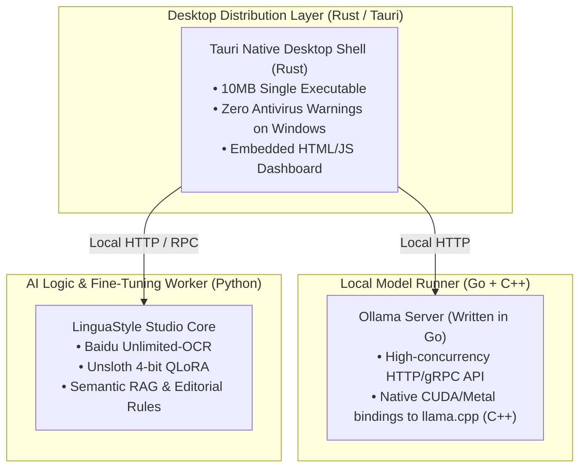

# Architecture Decision Record (ADR): Language & Ecosystem Tradeoffs
### Why Python vs. Rust vs. Go in the Book Translation & LinguaStyle Pipeline

This document analyzes the engineering tradeoffs behind choosing **Python**, **Rust**, and **Go** across different subsystems of the **Book Translation App** (Baidu Unlimited-OCR + LinguaStyle Studio RAG on an RTX 4070 8GB).

---

## 1. Executive Summary: The 99% Rule in Deep Learning

In modern deep learning systems:
$$\text{Total Execution Time} \approx 1\% \text{ High-Level Orchestration} + 99\% \text{ GPU Matrix Multiplication (CUDA/C++)}$$

- High-level languages (Python, Go, Rust) spend milliseconds tokenizing and dispatching memory pointers.
- The actual tensor math, attention mechanisms, and matrix multiplications run inside compiled C++/CUDA kernels on the GPU silicon.
- Replacing Python with Rust or Go for model execution yields **0% speedup** because the GPU hardware throughput remains the identical bottleneck.

Therefore, language selection is dictated by **ecosystem availability**, **CUDA kernel support**, and **memory optimization libraries**.

---

## 2. Why Python is Mandatory for the AI Core

| Subsystem | Python Implementation | Rust / Go Reality |
|---|---|---|
| **Baidu Unlimited-OCR** | Provided as native **PyTorch/Python** code using custom Reference Sliding Window Attention (R-SWA). | **Does not exist in Go or Rust.** Rewriting R-SWA and compiling custom CUDA attention kernels in Rust (Candle/Burn) or Go would take months of reverse engineering. |
| **8GB Fine-Tuning (QLoRA)** | **Unsloth** uses custom OpenAI **Triton** kernels written for Python to cut VRAM by 80%, fitting 7B model training inside an 8GB GPU. | Triton and Unsloth have no equivalent in Go or Rust. Standard fine-tuning in Rust/Go would trigger Out-Of-Memory (`CUDA OOM`) on an 8GB card. |
| **CUDA Driver Interop** | PyTorch wheels bundle precompiled CUDA 12.x binaries, FlashAttention, and cuDNN out of the box. | Linking CUDA in Go (via `cgo`) or Rust (`bindgen`/`cc`) on Windows is notoriously brittle with MSVC toolchains. |

---

## 3. Where Go and Rust Excel (and How We Leverage Them)

While Python is essential for neural network execution, **Go and Rust are vastly superior for application distribution, concurrency, and desktop packaging**.

In fact, the recommended production stack already incorporates them:

### A. Go: The Inference Engine Backbone (Ollama)
The local inference engine recommended for this project—**[Ollama](https://github.com/ollama/ollama)**—is **written in Go**.
- Go handles concurrency, HTTP streaming, multi-threading, and model lifecycle management.
- Go binds directly to `llama.cpp` (C++) to achieve 45+ tokens/second on an RTX 4070 without Python runtime overhead.

### B. Rust: Lightweight Desktop Distribution (Tauri)
Shipping a desktop application in pure Python requires packaging the entire Python interpreter via PyInstaller (resulting in a 200MB+ bundle with frequent Windows Defender false positives).
- **Rust with [Tauri](https://tauri.app/)** wraps the LinguaStyle Studio web UI (`app/web/`) in a native Windows `.exe` or macOS `.app`.
- Produces a **tiny $\sim$10 MB installer** with minimal memory overhead, delegating heavy AI calls to background worker services.

### C. Go / Rust for High-Throughput Document Segmentation
For batch-processing thousands of pages, Go or Rust can be used as a micro-service to:
- Tokenize and chunk multi-gigabyte document corpora concurrently using Go goroutines or Rust Rayon threads.
- Feed structured text streams into the Python RAG engine.

---

## 4. Subsystem Language Matrix

| Component | Selected Language | Rationale |
|---|---|---|
| **Unlimited-OCR & Document Vision** | **Python (PyTorch)** | Native R-SWA architecture; zero alternative implementations exist in Rust/Go. |
| **4-bit QLoRA Fine-Tuning** | **Python (Unsloth/Triton)** | Custom Triton kernels allow 7B fine-tuning inside 8GB VRAM without OOM. |
| **Local Model Runner (LLM)** | **Go + C++ (Ollama / llama.cpp)** | Native Go concurrency + C++ hardware matrix acceleration for CUDA and Apple Metal. |
| **Desktop Shell & Installer** | **Rust (Tauri)** *(Recommended)* | Tiny 10MB binary, native OS windowing, cross-platform for Windows `.exe` and Mac `.dmg`. |
| **LinguaStyle Studio RAG Core** | **Python** | Pure standard library (zero external dependencies), cross-platform, fast prototyping. |

---

## 5. Conclusion & Architectural Recommendation

1. **Keep the AI Core in Python**:
   Do not rewrite Unlimited-OCR or Unsloth in Rust or Go. The time cost is prohibitive, and GPU execution speed will be identical.
2. **Use Go for Model Serving**:
   Use **Ollama** (written in Go) for GGUF model serving on both Windows (CUDA) and Mac (Metal).
3. **Use Rust for Production Desktop Packaging**:
   When packaging the app for non-technical users on Windows and Mac, use **Rust (Tauri)** to wrap the frontend and orchestrate the local services.
