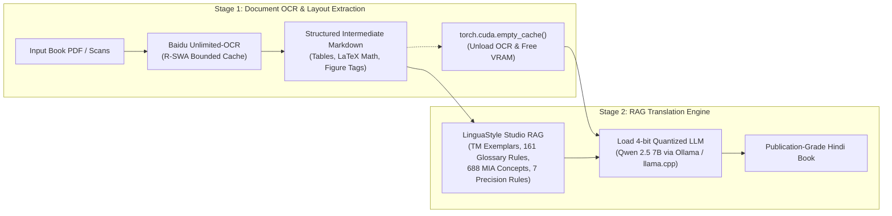

# Hardware & Technology Stack Guide
### RTX 4070 (8GB VRAM) Setup for Windows with macOS (Apple Silicon) Portability

This guide details the exact architecture, VRAM management strategy, and software stack required to run the **Book Translation App (Baidu Unlimited-OCR + LinguaStyle Studio RAG)** on an **NVIDIA RTX 4070 (8GB VRAM)** on Windows, with a zero-code-change path for porting to **macOS (Apple Silicon / Metal)**.

---

## 1. The 8GB VRAM Challenge & Staged Pipeline Architecture

On an 8GB GPU, running both a Vision-Language Document Model (Baidu Unlimited-OCR) and a 7B/8B Translation LLM simultaneously in VRAM can cause Out-Of-Memory (`CUDA OOM`) errors.

The solution is a **Staged Processing Architecture**:



1. **Stage 1 (Asset Extraction & OCR)**: Load Unlimited-OCR into CUDA, batch-process document pages into structured Markdown (with tables, LaTeX math, and image IDs), and then **unload the model and purge VRAM**.
2. **Stage 2 (Translation & Quality Audit)**: Load the 4-bit quantized translation LLM (consuming ~4.5–5.2 GB VRAM) into CUDA alongside the LinguaStyle Studio RAG engine to translate chunk by chunk.

---

## 2. Recommended Technology Stack

| Layer | Recommended Technology | Why for RTX 4070 (8GB) | Windows $\rightarrow$ Mac Portability |
|---|---|---|---|
| **Document OCR & Layout** | **Baidu Unlimited-OCR** + **PyMuPDF (`fitz`)** | Unlimited-OCR’s **R-SWA (Reference Sliding Window Attention)** restricts text cache to 128 tokens, transcribing dense books with constant VRAM (~3–4 GB). | Runs on PyTorch with CUDA on Windows; falls back to CPU/MPS on macOS. |
| **Local LLM Inference Engine** | **Ollama** or **llama.cpp** | Runs GGUF 4-bit quantized models at native speed with zero Python overhead. Consumes only **~4.4 GB VRAM** for a 7B model. | **100% identical API**: Uses NVIDIA CUDA on Windows; automatically uses Apple Metal (MPS) on macOS. |
| **Translation Model** | **Qwen 2.5 7B-Instruct (Q4_K_M)** | Superior multilingual performance for English $\rightarrow$ Hindi, preservation of technical terminology, and strong Markdown table adherence. | Standard GGUF format available on Ollama and HuggingFace. |
| **Fine-Tuning (LoRA / QLoRA)** | **Unsloth** + **HuggingFace PEFT** | Cuts VRAM usage by 80%, allowing you to **fine-tune Qwen 2.5 7B on an 8GB GPU** in 4-bit without OOM. | Run on Windows via WSL2/CUDA; Mac uses Apple MLX (`mlx-lm`). |
| **RAG & Memory Engine** | **LinguaStyle Studio** (Included) | Pure Python standard library subword vector similarity, glossary engine with negative avoid constraints, and 688 MIA concept definitions. | **Zero external dependencies**: Identical behavior on Windows, macOS, and Linux. |
| **Web / Desktop UI** | **FastAPI** + **Vanilla HTML/JS** (or **PyWebView**) | Lightweight REST backend; PyWebView can wrap the web UI into a standalone `.exe` on Windows and `.app` on macOS. | Cross-platform web standards. |
| **Environment & Package Manager** | **`uv`** or **Miniconda** | Ultra-fast package resolution; cleanly manages PyTorch CUDA wheels on Windows. | Native support on macOS and Windows. |

---

## 3. VRAM Budget on RTX 4070 (8GB)

```text
Total VRAM: 8192 MB (~8.0 GB)
OS / Desktop Display overhead: ~600 MB - 1000 MB
Usable VRAM for AI workloads: ~7.2 GB
```

### Stage 1: Unlimited-OCR Parsing
- Unlimited-OCR Base Weights (FP16 or INT8): **~3.2 GB**
- Image & Visual Attention Tokens: **~1.5 GB**
- R-SWA Text Cache (128-token sliding window): **~0.1 GB**
- **Total Stage 1 VRAM: ~4.8 GB** *(Fits comfortably within 7.2 GB usable VRAM)*

### Stage 2: Translation (via Ollama / llama.cpp)
- Qwen 2.5 7B-Instruct (4-bit Q4_K_M): **~4.4 GB**
- Context Window KV Cache (4k tokens): **~0.8 GB**
- LinguaStyle Studio RAG retrieval: **CPU / RAM (~100 MB)**
- **Total Stage 2 VRAM: ~5.2 GB** *(Smooth 45+ tokens/sec on RTX 4070)*

### Fine-Tuning Mode (Unsloth 4-bit QLoRA)
- Qwen 2.5 7B 4-bit Base Model: **~4.2 GB**
- LoRA Adapters (Rank 16, Alpha 16): **~0.3 GB**
- Gradient Checkpointing + 2k Context Window: **~2.2 GB**
- **Total Fine-Tuning VRAM: ~6.7 GB** *(Fits safely on 8GB with Unsloth)*

---

## 4. Cross-Platform Code Pattern (Universal Device Selector)

To ensure any Python code you write on Windows runs on macOS without edits, structure device initialization using this pattern:

```python
import torch

def get_compute_device() -> torch.device:
    """
    Automatically selects CUDA on Windows/Linux, 
    Metal (MPS) on Apple Silicon Mac, or CPU fallback.
    """
    if torch.cuda.is_available():
        device = torch.device("cuda")
        print(f"🚀 Using NVIDIA CUDA GPU: {torch.cuda.get_device_name(0)}")
    elif hasattr(torch.backends, "mps") and torch.backends.mps.is_available():
        device = torch.device("mps")
        print("🍏 Using Apple Silicon Metal (MPS)")
    else:
        device = torch.device("cpu")
        print("⚠️ Using CPU Fallback")
    return device
```

---

## 5. Step-by-Step Setup on Windows (RTX 4070)

### Step 1: Install CUDA & PyTorch
1. Install **NVIDIA CUDA Toolkit 12.4** and the latest GeForce Game Ready / Studio driver.
2. In PowerShell or Command Prompt, install PyTorch with CUDA 12.4:
   ```powershell
   pip install torch torchvision --index-url https://download.pytorch.org/whl/cu124
   ```

### Step 2: Set Up Ollama for Windows (Fast Local Inference)
1. Download and install [Ollama for Windows](https://ollama.com/download/windows).
2. Pull the multilingual 7B model:
   ```powershell
   ollama run qwen2.5:7b
   ```
   *(Ollama automatically detects your RTX 4070 and offloads 100% of layers into CUDA VRAM).*

### Step 3: Run the Book Translation Pipeline
In your `translation-style-studio` directory:
```powershell
# 1. Start the LinguaStyle Studio web server
python run.py 8080

# 2. Run the translation pipeline on your OCR-parsed Markdown
python scripts/translate_book_pipeline.py
```

---

## 6. Migration Guide for macOS (Apple Silicon / Metal)

When moving this project from Windows to a Mac with Apple Silicon (M1/M2/M3/M4):

1. **Inference (Ollama)**:
   - Install Ollama for Mac (`brew install ollama`).
   - Run `ollama run qwen2.5:7b`.
   - Ollama automatically detects Apple Silicon and uses **Metal Performance Shaders (MPS)** via unified memory.
2. **PyTorch Code**:
   - `get_compute_device()` automatically detects `torch.backends.mps.is_available()` and uses the Mac GPU.
3. **Fine-Tuning**:
   - Use Apple's native **MLX framework** (`pip install mlx-lm`) to fine-tune 4-bit LoRA models directly on unified memory.
4. **LinguaStyle Studio Core**:
   - Runs identically on macOS with zero modifications (pure Python standard library).
