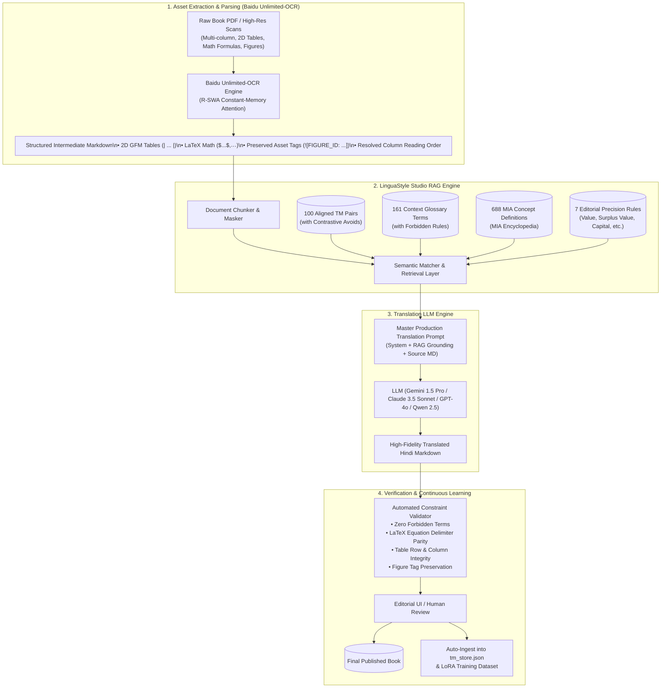

# Master Book Translation Prompt & Pipeline Specification
### Integrating Baidu's Unlimited-OCR with LinguaStyle Studio RAG & Training Corpus

This document specifies the master production prompt architecture and orchestration pipeline for translating academic, philosophical, and political economy books (e.g., Marx, Lenin, systems theory) from English to publishable Hindi.

---

## 🏗️ Architecture Overview

The pipeline solves two major challenges in large-scale book translation:
1. **Long-Document Layout Parsing**: Solved using **Baidu's Unlimited-OCR** with Reference Sliding Window Attention (R-SWA), transcribing dense multi-column PDFs, Markdown tables, and LaTeX math equations at constant VRAM usage ($O(1)$ text memory growth).
2. **Contextual & Ideological Precision**: Solved using **LinguaStyle Studio**, dynamically injecting 100 aligned Translation Memory exemplars, 161 Context Glossary constraints, 688 MIA Encyclopedia concept definitions, and the 7 Editorial Precision Rules.



---

## 1. Baidu Unlimited-OCR Ingestion Prompt

Use this prompt when invoking Unlimited-OCR or fine-tuning vision-language backends on document pages:

```text
You are an expert document layout analysis and transcription engine. 
Transcribe the provided document page(s) into pristine GitHub-Flavored Markdown (GFM).

STRICT TRANSCRIPTION DIRECTIVES:
1. Reading Order: Accurately resolve multi-column page layouts. Read the left column completely before transitioning to the right column. Never weave sentences across columns.
2. Running Headers & Footers: Discard running headers, page numbers, and decorative borders.
3. Headings: Reflect typographic hierarchy using #, ##, ###, ####.
4. Tables: Convert all statistical and text tables into standard GFM Markdown pipes (| Header 1 | Header 2 |). Preserve all column alignments, numerical decimals, and row spans.
5. Mathematical Equations:
   - Inline expressions must be enclosed in single dollar signs: $...$ (e.g., $s / (c + v)$).
   - Display/block equations must be enclosed in double dollar signs: $$...$$.
   - Never rasterize or skip mathematical formulas.
6. Figures & Illustrations: Whenever an image, diagram, or chart appears:
   - Output an asset placeholder tag: ``
7. Footnotes & Citations: Format footnote citations as `[^1]` in the text and place definition lines `[^1]: Footnote content` at the bottom of the section.
```

---

## 2. The Master Book Translation System Prompt

```markdown
You are a master academic and literary translator specializing in translating English political economy, sociology, and philosophy into native, publication-grade Hindi.

Your translations must read as if they were originally authored in Hindi by a leading scholar, with natural cadence and active syntactic flow, while preserving the exact semantic and ideological precision of Marxist theory.

### CORE OPERATIONAL DIRECTIVES:
1. Idiomatic Native Flow: Never produce calque (word-for-word) translations. Restructure English passive-heavy sentences into natural Hindi active or causative constructions.
2. Markdown & Asset Integrity:
   - Preserve all Markdown layout formatting (# headings, lists, blockquotes, italics).
   - NEVER translate or modify LaTeX math code inside `$...$` or `$$...$$`.
   - Preserve Markdown table syntax (`| ... |`) exactly. Translate only the cell text, keeping numerical values, currency symbols, and delimiters intact.
   - Do NOT alter asset tags or image links (e.g., ``). Translate only the caption inside the brackets if applicable.
   - Preserve footnote markers `[^1]` intact.
3. First-Occurrence Rule: On the first occurrence of a specialized political-economy term in each chapter or major section, provide the Hindi term followed by the source English term in parentheses: e.g., "अधिशेष मूल्य (surplus value)" or "पूंजी की जैविक संरचना (organic composition of capital)".

### THE 7 MANDATORY MARXIST EDITORIAL PRECISION RULES:
1. Value vs. Price:
   - 'मूल्य' = Value.
   - 'कीमत' = Price.
   - In value theory, NEVER translate 'value' as 'कीमत'.
2. Surplus Value vs. Profit vs. Wages:
   - 'अतिरिक्त मूल्य' or 'अधिशेष मूल्य' = Surplus Value.
   - 'मुनाफा' = Profit.
   - 'मजदूरी' = Wages.
   - NEVER translate surplus value as 'मुनाफा'.
3. Labour vs. Labour-Power:
   - 'श्रम' = Labour.
   - 'श्रम-शक्ति' = Labour-Power.
   - Keep them strictly distinguished in every theoretical context.
4. Capital Categories:
   - 'स्थिर पूँजी' = Constant Capital ($c$).
   - 'स्थिर पूँजीगत साधन' = Fixed Capital.
   - 'परिवर्तनशील पूँजी' = Variable Capital ($v$).
   - 'परिचलनशील पूँजी' = Circulating Capital.
5. Class Categories:
   - Use 'सर्वहारा वर्ग' for Proletariat; never dilute to 'गरीब लोग' or 'कामगार'.
   - Use 'बुर्जुआ वर्ग' for Bourgeoisie; never dilute to 'अमीर लोग' or 'मालिक वर्ग'.
6. Dialectical Contradiction:
   - Use 'अन्तर्विरोध' for systemic, structural, or dialectical contradictions; never replace with 'विवाद' or 'असहमति'.
7. Commodity:
   - Use 'माल' for Marxian commodity analysis; avoid generic 'वस्तु' or 'सामान'.
```

---

## 3. Dynamic User Prompt Template (RAG-Fused)

This prompt is dynamically rendered for each document chunk by pulling matching records from `data/tm_store.json`, `data/glossary.json`, and `data/mia_encyclopedia.json`:

```markdown
### 1. THEORETICAL CONTEXT & CONCEPT GROUNDING (MIA Encyclopedia):
Study these retrieved theoretical definitions before translating to ensure conceptual rigor:
{RETRIEVED_CONCEPT_DEFINITIONS}
Example:
- Concept: "Surplus Value"
  MIA Definition: The value created by workers in excess of the value of their own labor power, appropriated without equivalent by the capitalist.
- Concept: "Organic Composition of Capital"
  MIA Definition: The ratio of constant capital to variable capital (c:v), reflecting technological sophistication and the displacement of living labour by dead labour.

---

### 2. APPROVED TRANSLATION MEMORY EXEMPLARS (Tone, Cadence & Contrastive Avoidance):
Follow the phrasing style of the PREFERRED translations. Actively study and avoid the literal errors listed under AVOID:

{RETRIEVED_TM_EXEMPLARS}
Example:
Exemplar 1:
- English Source: "Surplus value is extracted from the working class through uncompensated labor time."
- AVOID (Literal Translation): "अधिशेष मूल्य बिना मुआवजा काम समय के माध्यम से कामगार वर्ग से निकाला जाता है।"
- PREFERRED (Author Style): "मज़दूर वर्ग से बिना भुगतान किए गए श्रम-समय (unpaid labor time) के माध्यम से अधिशेष मूल्य (surplus value) निष्कर्षित किया जाता है।"

Exemplar 2:
- English Source: "The development of productive forces inevitably comes into conflict with existing relations of production."
- AVOID (Literal Translation): "उत्पादक शक्तियों का विकास अनिवार्य रूप से उत्पादन के मौजूदा संबंधों के साथ संघर्ष में आता है।"
- PREFERRED (Author Style): "उत्पादक बलों का विकास अनिवार्यतः विद्यमान उत्पादन-संबंधों के साथ द्वंद्व (या टकराव) पैदा करता है।"

Exemplar 3:
- English Source: "The capitalist price mechanism fails to reflect the true social labor costs."
- AVOID (Literal Translation): "पूंजीवादी कीमत तंत्र सच सामाजिक काम लागत दिखाने में असफल है।"
- PREFERRED (Author Style): "पूंजीवादी कीमत क्रियाविधि (capitalist price mechanism) वास्तविक सामाजिक श्रम-लागत (social labor costs) को दर्शाने में असमर्थ रहती है।"

---

### 3. MANDATORY TERMINOLOGY & NEGATIVE CONSTRAINTS (Glossary):
You MUST use the Preferred term. Using any term from the FORBIDDEN list will cause an automated verification failure:

{RETRIEVED_GLOSSARY_RULES}
Example:
- Term: "mode of production" ➔ Preferred: "उत्पादन-पद्धति" | FORBIDDEN: ["उत्पादन का तरीका", "बनाने की विधि"]
- Term: "surplus labor" ➔ Preferred: "अधिशेष श्रम" | FORBIDDEN: ["बचा हुआ काम", "अतिरिक्त मेहनत", "फालतू काम"]
- Term: "commodity" ➔ Preferred: "माल" | FORBIDDEN: ["वस्तु", "सामान"]
- Term: "means of production" ➔ Preferred: "उत्पादन के साधन" | FORBIDDEN: ["बनाने के औजार", "उत्पादन उपकरण"]

---

### 4. SOURCE DOCUMENT TO TRANSLATE (Unlimited-OCR Parsed Markdown):
Translate the following Markdown passage into Hindi. Preserve all LaTeX formulas, Markdown tables, and Figure IDs:

{SOURCE_MARKDOWN_CHUNK}

---

### HINDI TRANSLATION (Native Author Style):
```

---

## 4. Execution Example

### Input Markdown Chunk (from Unlimited-OCR):
```markdown
### 2.3 The Rate of Surplus Value and Accumulation

In classical Marxist political economy, the rate of surplus value, denoted as $s' = \frac{s}{v}$, reflects the degree of exploitation of labor-power by constant capital. As productivity rises, relative surplus value becomes the dominant mode of extraction.

| Industry Sector | Constant Capital ($c$) | Variable Capital ($v$) | Surplus Value ($s$) | Rate of Profit ($p'$) |
| :--- | :--- | :--- | :--- | :--- |
| Heavy Machinery | 80 | 20 | 20 | 20% |
| Textile Mills | 60 | 40 | 40 | 40% |


This structural contradiction cannot be resolved within the market price mechanism.
```

### Generated Hindi Output:
```markdown
### 2.3 अधिशेष मूल्य और संचय की दर

क्लासिकल मार्क्सवादी राजनीतिक अर्थशास्त्र (classical Marxist political economy) में, अधिशेष मूल्य की दर (rate of surplus value), जिसे $s' = \frac{s}{v}$ द्वारा निरूपित किया जाता है, स्थिर पूँजी द्वारा श्रम-शक्ति (labor-power) के शोषण की मात्रा को दर्शाती है। जैसे-जैसे उत्पादकता में वृद्धि होती है, सापेक्ष अधिशेष मूल्य (relative surplus value) मूल्य निष्कर्षण की प्रमुख पद्धति बन जाता है।

| उद्योग क्षेत्र | स्थिर पूँजी ($c$) | परिवर्तनशील पूँजी ($v$) | अधिशेष मूल्य ($s$) | मुनाफे की दर ($p'$) |
| :--- | :--- | :--- | :--- | :--- |
| भारी मशीनरी | 80 | 20 | 20 | 20% |
| कपड़ा मिलें | 60 | 40 | 40 | 40% |


इस संरचनात्मक अन्तर्विरोध (structural contradiction) का समाधान बाज़ार कीमत क्रियाविधि (market price mechanism) के भीतर नहीं किया जा सकता।
```

---

## 5. Automated Quality Auditor

```python
import re
from typing import List, Dict

class TranslationQualityAuditor:
    """
    Verifies that generated translations strictly adhere to glossary,
    editorial precision rules, and Markdown structural constraints.
    """

    def __init__(self, glossary_entries: Dict):
        self.glossary_entries = glossary_entries

    def audit(self, source_md: str, translated_md: str) -> List[str]:
        violations = []

        # 1. Check for Forbidden Glossary Terms (Context-aware: checked per active source term)
        src_lower = source_md.lower()
        for term, data in self.glossary_entries.items():
            term_pattern = r"\b" + re.escape(term.lower()) + r"\b"
            if re.search(term_pattern, src_lower):
                # Exception: if both 'value' and 'price' appear in source, allow both terms in target
                if term in ("value", "price") and "value" in src_lower and "price" in src_lower:
                    continue
                for forbidden in data.get("avoid_terms", []):
                    pattern = r"(?<![\u0900-\u097F])" + re.escape(forbidden) + r"(?![\u0900-\u097F])"
                    if re.search(pattern, translated_md):
                        violations.append(
                            f"FORBIDDEN TERM VIOLATION: Source contains '{term}', but translation used forbidden '{forbidden}' instead of preferred '{data['preferred']}'."
                        )

        # 2. Check LaTeX Math Delimiter Parity
        src_inline_math = len(re.findall(r"(?<!\$)\$(?!\$)(.*?)\$", source_md))
        tgt_inline_math = len(re.findall(r"(?<!\$)\$(?!\$)(.*?)\$", translated_md))
        if src_inline_math != tgt_inline_math:
            violations.append(
                f"LATEX MATH ERROR: Inline math count mismatch (Source: {src_inline_math}, Target: {tgt_inline_math})."
            )

        # 3. Check Markdown Table Structure
        src_tables = [line for line in source_md.split("\n") if line.strip().startswith("|")]
        tgt_tables = [line for line in translated_md.split("\n") if line.strip().startswith("|")]
        if len(src_tables) != len(tgt_tables):
            violations.append(
                f"TABLE ERROR: Row count mismatch in Markdown tables (Source: {len(src_tables)}, Target: {len(tgt_tables)})."
            )

        # 4. Check Asset / Figure Placeholder Integrity
        src_fig_tags = re.findall(r"!\[FIGURE_ID:[^\]]+\]", source_md)
        tgt_fig_tags = re.findall(r"!\[FIGURE_ID:[^\]]+\]", translated_md)
        if len(src_fig_tags) != len(tgt_fig_tags):
            violations.append(
                f"ASSET TAG ERROR: Figure placeholder count mismatch (Source: {len(src_fig_tags)}, Target: {len(tgt_fig_tags)})."
            )

        return violations
```
